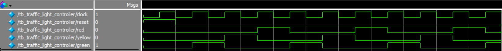
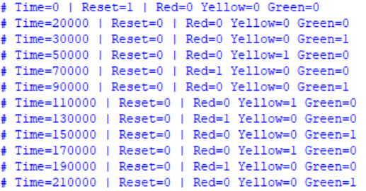

# Traffic Light Controller (Moore FSM)

A simple Moore FSM traffic light controller in Verilog, complete with a testbench, simulation waveforms, and a synthesized state diagram. Built to match the task specs for IIT Bombay's e-Yantra Robotics Competition (eYRC).

## How It Works

The FSM steps through four states on the rising edge of `clock` (with an asynchronous active-high `reset`):

| State | Encoding | Next State | Outputs (`red`, `yellow`, `green`) |
| :--- | :---: | :--- | :---: |
| `ST_INIT` | `2'b00` | `ST_GREEN` | `0, 0, 0` |
| `ST_GREEN` | `2'b01` | `ST_YELLOW` | `0, 0, 1` |
| `ST_YELLOW` | `2'b10` | `ST_RED` | `0, 1, 0` |
| `ST_RED` | `2'b11` | `ST_GREEN` | `1, 0, 0` |

### Synthesized State Diagram

## Simulation Results

Simulated in ModelSim using `tb_traffic_light_controller.v` with a `20 ns` clock period:

### Waveform

### Transcript Output

## Repo Layout

- `rtl/traffic_light_controller.v` — Moore FSM design module
- `tb/tb_traffic_light_controller.v` — Testbench with `$monitor` output
- `docs/` — State diagram, waveform, and transcript screenshots

## Notes

This design sticks strictly to the state flow, port names, and single-cycle transitions specified by the e-Yantra task. For a real-world setup, the natural next steps would be adding configurable state timers, sensor/pedestrian inputs, and multi-way intersection control.
